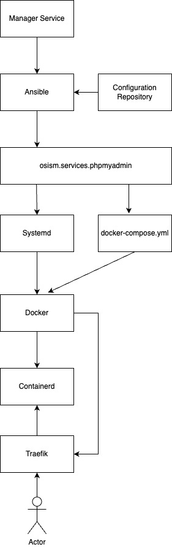
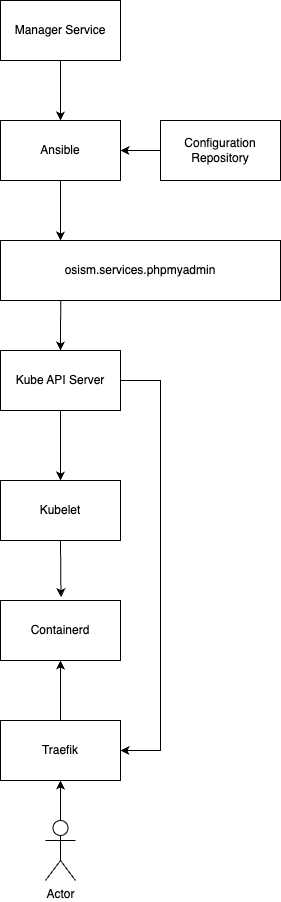

# Developer Guide

We welcome any issues, change requests or general feedback. Do not hesitate to open an issue: we can only
fix problems that we know about, so please report them even if they seem minor.

We use GitHub Issues to capture feature requests, feedback, bugs, etc. Open an issue in the repository where
the problem exists. If it is not yet clear which repository is affected, or if several repositories are affected,
use the [osism/issues](https://github.com/osism/issues/issues) repository. There are no specific requirements for the creation of an issue.
Error cases should be described in such a way that they are directly reproducible. The more outputs there are,
the better.

## Contribution workflow

We use GitHub pull requests for contributions. How pull requests work is documented in the
official [GitHub documentation](https://docs.github.com/en/pull-requests). It is recommended
to use the [GitHub CLI](https://cli.github.com), which makes many of the following steps easier.

1. **Open an issue.** Describe the bug or the feature first, so that the change can be discussed before
   you start working on it. Open the issue in the repository where the problem exists. Use
   [osism/issues](https://github.com/osism/issues/issues) only if it is not yet clear which repository
   is affected, or if several repositories are affected.
2. **Create a branch.** External contributors work on a branch in their own fork of the repository, as
   described in the [GitHub documentation](https://docs.github.com/en/pull-requests/how-tos/create-pull-requests).
   Members of the OSISM team push their branch directly to the repository in the `osism` organization.
3. **Commit your changes.** Follow the [commit message guidelines](./style-guide.md#commit-messages).
   Every commit needs a `Signed-off-by` trailer from the person who takes responsibility for the change.
   We are transparent about AI assistance: if an AI coding assistant helped create a change, add an
   `Assisted-by` trailer that names the assistant, as described in
   [Attribution for AI-assisted changes](./style-guide.md#attribution-for-ai-assisted-changes).
   `Signed-off-by` is always the last line and is never used for an AI assistant.
4. **Open a pull request.** Open it against the default branch of the repository and link the issue
   it addresses.
5. **Pass the CI checks.** All CI checks of the pull request must pass. Most repositories run them in
   [Zuul CI](./zuul.md). Depending on the repository, the checks include linters such as `ansible-lint`,
   `yamllint`, `flake8`, `python-black`, `mypy` and `hadolint`. Their configuration files, for example
   `.ansible-lint`, `.yamllint.yml` and `.flake8`, are in the root of each repository. Some long-running
   jobs only start once the [`zuul` label](./zuul.md#the-zuul-label) has been assigned to the pull request.
6. **Review and merge.** At least one OSISM maintainer reviews the pull request. The maintainer who
   approves it also merges it.

## How to add a new service

If you want to add a new service to OSISM, this is done via an Ansible role and (most often)
a container image. The following steps are necessary and are demonstrated using the example
of `osism.services.cgit`.

| Description                                                                        | Example                                                               |
|:-----------------------------------------------------------------------------------|:----------------------------------------------------------------------|
| Add the Ansible role in one of the Ansible collection repositories                 | https://github.com/osism/ansible-collection-services/pull/578/files   |
| Add the Ansible playbook                                                           | https://github.com/osism/ansible-playbooks/pull/215/files             |
| Add the Ansible inventory group                                                    | https://github.com/osism/generics/pull/225/files                      |
| Add the used container image(s) to the release repository                          | https://github.com/osism/release/pull/278/files                       |
| Add the container images(s) to osism-ansible container image                       | https://github.com/osism/container-image-osism-ansible/pull/215/files |
| Add the container image registry/registries and host(s) to the defaults repository | https://github.com/osism/defaults/pull/54/files                       |
| Add a sample deployment to the testbed                                             | https://github.com/osism/testbed/pull/1043/files                      |

## How to add a new container image

If required, add a new container image in the [osism/container-images](https://github.com/osism/container-images)
repository. The example here is from the `osism.services.keycloak` role: https://github.com/osism/container-images/pull/34/files.

Whenever possible, upstream container images should be used. If only minor customizations are necessary,
always work with overlay container images based on upstream container images.

An image built from a release tag carries the labels described in
[Container Image Labels](./container-image-labels.md).

## How service deployment works

### Docker

### Kubernetes

